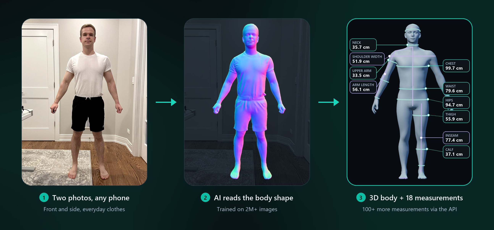
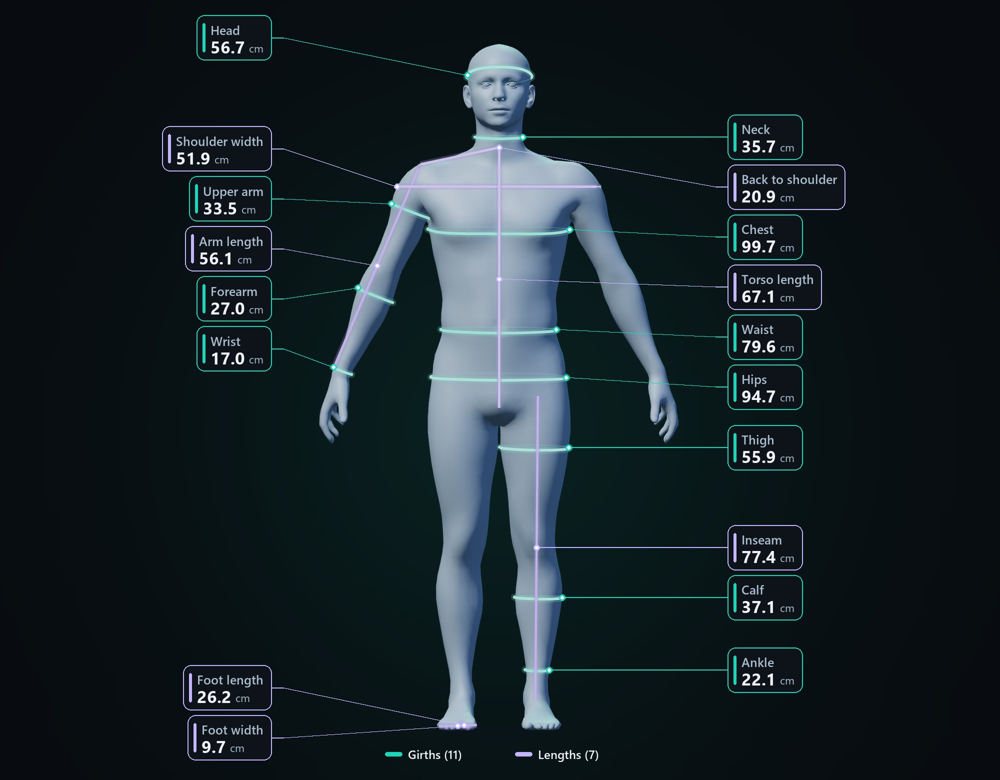

  

  <h3>3D body scanning from two photos, in everyday clothing.</h3>

  100+ body measurements and a 3D body model in about 5 seconds, inside your product. 
  Any smartphone. No hardware, no special clothing, no studio.

---

  

| **1.6 cm** | **100+** | **~5 s** | **2M+** |
|:---:|:---:|:---:|:---:|
| average error in everyday clothing, across 18 standard measurements | body measurements, or your own custom set | from photos to measurements and 3D model | training images behind the models |

---

## What Your System Gets Back

Your users take a front and a side photo inside your product. One API call returns:

  

- **Body measurements**: 100+ standard measurements, or a custom set you define in the [measurement builder](https://demo.snapmeasureai.com/measurement-builder)
- **A 3D body model**: OBJ or glTF, in our measuring A-pose, a T-pose or your own arm and leg angles, with a watertight mesh on request
- **Raw geometry**: vertices, landmarks and each measurement's outline, for your own viewer or scan-to-scan comparison
- **Size recommendations**: each wearer mapped onto your own size charts
- **An embeddable 3D viewer**: ready to show inside your app or site, under your brand

Built on Cambridge research. Every body shape, every skin tone, real-world clothing.

---

## Built For

| Industry | What it does |
|---|---|
| 💊 **[GLP-1 & weight loss](https://snapmeasureai.com/patient-engagement-platform/)** | Show patients how their body changes, scan to scan, beyond the number on the scale |
| 🦺 **[Uniforms & workwear](https://snapmeasureai.com/uniform-sizing/)** | Size every wearer remotely, with no fitting days |
| 👔 **[Apparel & made-to-measure](https://snapmeasureai.com/apparel-sizing/)** | Size recommendations, made-to-measure and fit development |
| 🏋️ **Fitness platforms** | Track body change without a hardware scanner |

---

## Integration

- **REST API**: two photos and a height in; measurements, a 3D model and sizes out. [Developer docs →](https://snapmeasureai.com/developers/)
- **Capture SDK**: a guided camera flow that runs inside your own web page, on your domain and in your brand, in one small script
- **White-label**: the 3D viewer and capture screen carry your brand, not ours
- **Keys for every setup**: server keys for your backend, browser keys locked to your own websites
- **Deployment**: our shared cloud, or a dedicated environment in the AWS region you choose

---

## Security and Privacy

- **Photos are never stored.** They are processed in memory and released as soon as the response is sent: never written to disk, a database or logs.
- **No personal data needed.** A scan needs photos and a height, nothing else. No names, emails or accounts.
- **Logs hold no request content.** No photos, heights, measurements, 3D models or IP addresses.
- **Encrypted in transit** with TLS 1.2 or higher (1.3 on current devices), and API keys stored only as hashes.
- **Dedicated environments** on request: your own network, servers and keys, in your chosen region.

---

  <video src="https://github.com/user-attachments/assets/8c962d20-5444-46cc-9b0f-b88c1815fa91" controls="controls" muted="muted" playsinline="playsinline" style="clip-path: inset(1px 1px);"/>

---

## More From the Team

- [**AI motion capture**](https://snapmeasureai.com/motion-capture-from-video/): 3D motion data from any video
- [**Synthetic data**](https://snapmeasureai.com/synthetic-data-with-labels/): photorealistic people with exact 3D labels

---

## Get Started

**See it on yourself in the [live demo](https://demo.snapmeasureai.com), free with no account.** 
For API access or a pilot, [contact us](https://snapmeasureai.com/contact/) or email info@snapmeasureai.com.

---

© SnapMeasureAI, LLC · Chicago, IL · [snapmeasureai.com](https://snapmeasureai.com) · [Privacy](https://snapmeasureai.com/privacy/) · [Terms](https://snapmeasureai.com/terms/) · Measurements are estimates for sizing and progress tracking, not medical measurements.
